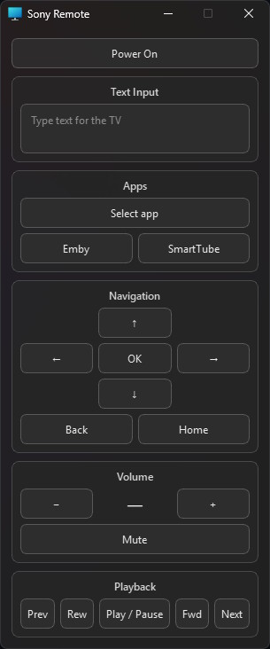

# Sony-Remote-Control

Small PySide6 desktop remote for Sony BRAVIA TVs using the Sony BRAVIA IP Control API (only tested on XR-55X90J)



## Installation

Place these files in the same folder.

```text
SonyRemote.pyw
SonyRemote.json
```

## Windows

```powershell
py -m pip install PySide6
```

Run `SonyRemote.pyw`.

## macOS

```bash
python3 -m pip install PySide6
python3 SonyRemote.pyw
```

## Linux

```bash
python3 -m pip install PySide6
python3 SonyRemote.pyw
```

## TV setup

On the TV, open:

`Settings > Network and Internet > Home network setup > IP Control`

Set:

- `Authentication` — Normal and Pre-Shared Key.
- `Pre-Shared Key` — choose a key and enter the same value in `SonyRemote.json`.
- `Simple IP Control` — enable this if you want the remote to power on the TV.

## Configuration

```json
{
  "Host": "192.168.1.5",
  "PreSharedKey": "2468",
  "DarkMode": true,
  "Mica": true,
  "TextInputControls": true,
  "ChannelControls": true,
  "AppControls": true,
  "NavigationControls": true,
  "InputControls": false,
  "VolumeControls": true,
  "AmplifierTVInput": "",
  "PlaybackControls": true,
  "DiagnosticsEnabled": false,
  "SortByName": false,
  "Apps": {},
  "Inputs": {},
  "SystemTray": false,
  "CloseToTray": false,
  "DropdownAnimationWorkaround": true
}
```

- `Host` — IP address or hostname of the Sony TV.
- `PreSharedKey` — pre-shared key configured in the TV's IP Control settings.
- `DarkMode` — `true` or `false`.
- `Mica` — Windows-only Mica background. Ignored on macOS and Linux.
- `TextInputControls` — show the Text Input section. Text is sent to the currently active TV software keyboard or text field by pressing Enter.
- `ChannelControls` — show number buttons `0`–`9` and channel `−` / `+` controls.
- `AppControls` — show the application launcher and favorite application buttons.
- `NavigationControls` — show directional, OK, Home, and Back controls.
- `InputControls` — show the input selector and favorite input buttons.
- `VolumeControls` — show volume and mute controls.
- `PlaybackControls` — show media playback controls.
- `AmplifierTVInput` — empty by default, which disables amplifier routing. Set the exact amplifier input ID used by the TV (for example `hdmi1`, `optical1`, or `tv`). Use the input ID, not its display name.
- `DiagnosticsEnabled` — `false` by default. Set to `true` to append unexpected errors and crash diagnostics to `SonyRemote-crash.log` beside the script. Logs contain the app version, exception types, and stack locations; exception messages, source lines, request data, and local variable values are omitted. If the log cannot be opened or written, the app continues without logging.
- `SortByName` — `false` (default) keeps favorites and dropdown entries in JSON insertion order; `true` sorts them alphabetically by `NameOverride`, falling back to `Name`, ignoring case. Apps and inputs are ordered separately.
- `Apps` — settings for applications discovered from the Sony TV.
  - `Name` — name reported by the TV. This is updated automatically.
  - `NameOverride` — optional replacement name shown in the dropdown and on favorite buttons.
  - `Hidden` — hide the application from the dropdown menu. Hidden applications can still be favorites.
  - `Favorite` — show a button for the application directly in the remote.
- `Inputs` — settings for inputs discovered from the Sony TV.
  - `Name` — name reported by the TV. This is updated automatically.
  - `NameOverride` — optional replacement name shown in the dropdown and on favorite buttons.
  - `Hidden` — hide the input from the dropdown menu. Hidden inputs can still be favorites.
  - `Favorite` — show a button for the input directly in the remote.
- `SystemTray` — show a system tray icon when the desktop supports it. If unavailable, the app runs as an ordinary window.
- `CloseToTray` — clicking the window close button hides the app to the tray instead of exiting. If no tray is available, closing the window exits normally.
- `DropdownAnimationWorkaround` — suppress a Qt/Windows repaint glitch where controls underneath an opening dropdown can briefly show through the menu animation. Usually only needed on Windows.

SonyRemote automatically adds newly discovered applications and inputs to `Apps` and `Inputs` with default settings. Existing `NameOverride`, `Hidden`, and `Favorite` values are preserved. Existing entries keep their JSON positions; newly discovered entries append in device discovery order. Dropdowns only include currently discovered, non-hidden entries. Favorite buttons remain independent of `Hidden`. Name sorting affects display only and does not reorder the JSON file.

The app automatically restarts when it detects that `SonyRemote.json` has changed.

Only one instance of SonyRemote can run at a time.

Regular status polling pauses while the window is hidden or minimized and refreshes immediately when restored. Active requests finish normally; configuration file watching remains enabled.

## Windows shortcut reliability

Version `2026.10.18.3` fixes the native hook chain used when both remotes run. All Windows shortcuts still use a low-level Windows keyboard hook. Qt only observes focus changes and delivers queued commands to the GUI; it does not intercept Windows hotkeys.

The hook uses pointer-sized Win32 arguments and return values throughout, so forwarding an unclaimed key preserves its original event pointer on 64-bit Windows. A dedicated native message thread keeps forwarding responsive during GUI work and restart waits. The callback reads a plain focus/ownership snapshot and queues commands; device and IPC requests run outside it. Other apps' keys are forwarded unchanged.

A physical press keeps its original owner until release. Mute toggles once per press; volume and navigation keys can repeat while held. Commands use a bounded queue; an unaccepted new press passes through. Sony defers volume/mute keys while the amplifier's global ownership is valid, regardless of which remote started first. Hook failures are reported while the remote remains usable through its buttons.

## Local amplifier routing

Version `2026.10.18.2` and newer can cooperate with Yamaha Remote `2026.10.18.2` and newer over a user-local Qt socket. Both apps remain self-contained; neither reads the other's JSON. No additional dependencies are needed.

Set, for example, `"AmplifierTVInput": "hdmi1"` in `SonyRemote.json`. Use the corresponding key from Yamaha Remote's `Inputs` setting, not a `NameOverride`. While the amplifier is reachable, on, and using that input, Sony's volume/mute buttons and focused volume keys send commands directly to it. While routing, the volume number and mute label follow the amplifier's published state, including changes made directly through Yamaha Remote. A matching calibration supplies the TV-scale number; otherwise the number is raw amplifier volume. Its tooltip identifies the source. The TV's own stored volume remains separate.

Standby, another amplifier input, offline state, a disconnected socket, or expired status automatically restores ordinary TV volume control. When Yamaha's global volume hook is actually active, Sony passes its focused volume/mute keys through so Yamaha handles each press. This hotkey ownership applies on every amplifier input, independently of whether Sony's volume buttons route to it. Disabling global hotkeys, losing the connection, or losing valid ownership restores Sony's focused shortcuts. Other shortcuts retain their existing behavior.

Connection attempts are asynchronous and silent when no amplifier app is running. A two-second reconnect timer runs only while disconnected; no periodic IPC state requests are sent. Connected clients receive state updates from existing device polls and state events. A freshness deadline prevents continued use of stale state if the amplifier app stops responding. If Sony starts first, routing becomes available automatically after the amplifier app starts.

A routing change cancels pending TV volume rate-limit targets. An already-running TV request may still finish. Amplifier commands use its existing serialized worker and bounded queue, bypassing Sony's TV/CEC rate limiter. Rejected commands and acknowledgement failures are reported without retrying against either device, because a retry could apply a volume step twice. Acknowledgements confirm queue acceptance rather than completed device execution.

The amplifier's reported raw maximum is an API ceiling, not its physical volume limit. With a matching calibration file, Sony displays the observed TV-scale equivalent of amplifier volume, capped to the calibrated TV range. It does not write a converted volume back to the TV. Without a matching mapping it displays the amplifier raw value.

## Calibration helper — session and restoration stage

Release `2026.10.18.5` adds exclusive calibration sessions. Update **both** remotes before using `VolumeCalibration.pyw`, available in the Sony Remote repository. The helper is a separate, self-contained PySide6 application and communicates only through generic local IPC endpoints. It does not read either remote's settings or credentials.

During a session, both remotes reuse their existing polling timers at 250 ms, including while hidden. Ordinary controls are disabled and pending volume targets are cleared. Yamaha's Windows hook consumes volume/mute media keys without issuing device commands, so they cannot unmute Windows or change volume during the test. Config-driven restarts wait until the session ends. A socket-owned eight-second lease, renewed by the helper, restores normal polling and controls on release, disconnect, or helper failure. Only the owner can perform calibration operations; API work stays in the existing device workers.

The helper first captures the selected amplifier input through IPC. The input and mapping are now saved in `VolumeCalibration.json` after a successful full sweep and restoration. `AmplifierTVInput` remains a fallback setting; the calibrated input takes precedence only for the matching configured devices.

### Full calibration sweep and results — 2026.10.18.14

Update **VolumeCalibration.pyw** to `2026.10.18.14`; Sony Remote can remain at `2026.10.18.11` and Yamaha Remote at `2026.10.18.10`. Keep the helper beside `SonyRemote.pyw` so its separate `VolumeCalibration.json` is in the location Sony watches. Neither remote reads the other remote's settings. Both scripts and the helper remain self-contained.

1. Start both remotes and select the amplifier input physically connected to the TV. Start below the amplifier API ceiling, with TV/amplifier mute states initially agreeing.
2. Set the **TV to a silent input/source**, stop all other playback, and keep the same Windows output selected. Volume changes may unmute the TV/amplifier. Windows mute does not silence TV-generated audio or other amplifier sources. A full sweep can reach a very loud range if the source becomes active.
3. Confirm the silent-source checkbox. The sweep starts at the TV's reported minimum. The default upper limit is the amplifier API ceiling; optionally select a lower reachable upper limit. The original volume is restored afterward unless a lower safe TV restore volume is selected.
4. Click **Run full calibration sweep**. The helper waits for three seconds of settled device observations, saves recovery state, mutes Windows, and verifies a relative CEC step. It moves the TV to its reported minimum, then measures upward one relative step at a time. Above five TV levels from minimum, positioning waits for each amplifier movement without the full per-step settling delay. At the transition to within five levels, a five-second quiet interval resynchronizes TV/amplifier readings before full step verification resumes; the minimum baseline must settle for three seconds. If amplifier raw volume reaches zero while the TV number is still catching up, positioning waits for the TV minimum instead of sending another downward command. There is no full downward measurement pass. At the first reported API ceiling it stops increasing immediately; it never explores the unobservable physical range beyond it. Reaching the TV's maximum or the selected upper limit also ends the upward pass.
5. Any skipped integer amplifier values are checked through additional relative CEC approaches, twice from below and twice from above. If an approach reaches the value, it becomes a measured point. Only values repeatedly crossed without being reached qualify for interpolation.
6. The helper waits for pending CEC activity to become quiet, returns toward the saved volume using the same faster movement as initial positioning, then restores and verifies saved volume/mute states. Fast restoration is used only while more than five TV levels from the restore target; it also stops within five raw units of an exact saved amplifier target. A five-second quiet interval resynchronizes readings before the final fully verified approach. This works from above or below the target and for an optional lower safe restore volume. The exact saved raw value remains the target when restoring the original volume; a lower safe TV restore target cannot raise the amplifier above its original raw value. Windows mute is restored last, and only then is the mapping atomically published. Both remotes' normal polling and controls resume. Calibration may take several minutes; progress appears in the log and activity indicator.

**Run step check only** retains the shorter preflight/restoration workflow and does not replace a mapping. **Cancel and restore**, or closing the helper during work, waits for an issued relative step to settle and performs cleanup. A cancelled/failed sweep or failed restoration leaves the previous active mapping intact and retains collected observations in an inactive draft. Restoration failures retain the recovery record and leave Windows muted where possible. Keep the source silent and use **Recover saved states**; do not delete the JSON to bypass recovery. Older recovery records remain supported.

Relative commands are `+1` / `-1`; an amplifier raw change is valid even when the TV number stays unchanged, and every accepted measurement is retained. Fresh observations from both devices are required. Movement must settle at the first observed amplifier value; continued movement during settling is inconclusive. Quick positioning uses amplifier movement for direction checks and records no mapping data. A transient TV-only reading in the opposite direction is allowed to catch up: verified steps wait for it to correct and settle before accepting a measurement. A persistent inconsistent TV pair still enters bounded recovery. An actual amplifier raw reversal stops the run immediately, with both before/after raw and TV values in the error message.

If a command produces no confirmed amplifier change within five seconds, or its movement fails to settle, the helper pauses commands and observes for **five quiet seconds** (up to twenty seconds if status keeps changing). A late single raw step can be accepted after settling without another command. Otherwise it restores the **previous accepted amplifier raw value and TV value**, using verified relative commands, and confirms a quiet pair before retrying the original step. It allows the initial attempt plus three retries. TV-only changes are not accepted as amplifier measurements. Larger delayed changes are rolled back even if they fit within one coarse TV display level, since they might include queued commands. Rollback movements do not become calibration observations.

Rollback is nonrecursive and bounded to sixteen correction commands / three minutes, with a maximum of four consecutive commands making no progress. An unreachable previous pair, missing observations, API/IPC errors, disconnection, changed input, opposite amplifier movement, or lost session ownership stops measurement and triggers normal session restoration. Cancellation waits for an issued step and any required rollback before restoration. The same relative-step recovery policy is used during positioning, measurement, gap checks, and ordinary session restoration.

The upward pass and positioning/restoration seeks are limited to 512 successful steps and fifteen minutes each. Additional gap verification has a shared limit of 2,048 steps and thirty minutes. No periodic IPC status requests are added: existing remote device timers provide the observations. Canonical calibration requires integer raw values and an integer upper limit no greater than 10,000; unsupported limits fail before device changes.

### Mapping file and results

`VolumeCalibration.json` keeps `format_version: 1`, the durable `recovery` record, a `last_session` report, an active `calibration` object, and an optional inactive `draft`. Each accepted measurement and completed gap check is atomically checkpointed to the draft. A complete candidate lookup is also saved there before session restoration. Failed/cancelled runs retain the draft with their outcome and restoration status; abrupt termination leaves its last checkpoint. Sony never uses drafts. Existing active calibration remains available, and only a valid completed lookup followed by successful restoration can replace it. Successful activation removes the redundant draft. Drafts preserve evidence for inspection; automatic resume or manual activation is not provided. Start a new sweep after any required recovery.

When no active mapping exists, the helper results table displays saved draft observations clearly marked inactive. If an active mapping exists, it remains the displayed result and the summary reports the separate draft. Mapping schema version 2 contains:

- Captured amplifier TV input, configured-TV/amplifier fingerprints, creation date, observed ranges, and the network API ceiling.
- All measured raw/TV `observations`, including changes within one TV display level.
- A dense `lookup` with one canonical TV value for **every integer amplifier raw value from zero through the calibrated maximum**.
- `gap_checks` preserving the verified crossings used to justify interpolated entries.

Each lookup entry identifies its origin as **measured**, **boundary-clamped**, or **interpolated**. If TV zero corresponds to amplifier raw one, raw zero also maps to TV zero. When several TV levels are observed at one amplifier value, the lowest observed TV level is canonical; all observations remain available. Thus amplifier raw 154 first observed at TV 80 maps to TV 80, even if a higher TV reading is subsequently observed at that same API ceiling.

For verified interior gaps, interpolation uses the nearest measured neighbors and preserves a monotonic TV scale. Integer rounding is selected using nearby measured transitions; the entry records its anchors and rounding method. This estimates a value CEC could not reach during repeated checks. Measured values are never replaced with estimates. Nonmonotonic measured conflicts prevent publication rather than silently changing measurements.

The results table lists every amplifier raw value, its canonical TV level, origin, and supporting evidence or interpolation method. The summary counts measured, clamped, and interpolated entries and reports conflicting observations. Results reload when the helper starts and after a run. The table is read-only; the JSON retains the complete observations and verification evidence.

Sony watches this file through its existing event-driven file watcher and loads changes without restarting. It uses the captured input only when both configured-device fingerprints match. With no matching file it keeps `AmplifierTVInput` and the raw amplifier display. Deleting/renaming the calibration file restores that fallback; a malformed edit retains the last valid in-memory mapping and reports the reload error in the volume tooltip (and optional diagnostics).

Canonical display lookup is independent of volume direction. **≈** marks interpolated estimates; measured and boundary-clamped entries display normally. Raw values outside the calibrated range clamp to its display endpoints. Mapping changes only Sony Remote's displayed volume; it does not write a matching volume to the physical TV. Existing schema-version-1 mappings remain supported with their earlier directional/approximate display behavior. Run a new full calibration to replace an older mapping with the canonical lookup.

Fingerprints currently identify the configured host endpoints, not hardware serial numbers. Recalibrate after replacing a device, even if its address stays the same. Recovery records also contain the original Windows endpoint ID, mute/volume states, and restore target, never credentials. Only one helper can own the JSON and remote sessions. Abrupt process/computer termination can interrupt restoration; the session leases expire while the durable recovery record permits a later recovery attempt.

The helper uses PySide6 plus standard-library Windows Core Audio COM bindings. Simulated-device and IPC checks do not replace testing physical CEC and Windows audio behavior on your devices.

## Text input

- **Enter** — Sends the text to the TV.
- **Ctrl+Enter** — Sends the text and automatically activates the TV keyboard action, such as **Search** or **Go**.
- **Shift+Enter** — Adds a new line instead of sending the text.

> **Note:** Ctrl+Enter cannot directly trigger the TV’s **Search**, **Go**, or similar action. It works by automatically navigating the on-screen keyboard to that button, so it depends on the keyboard using the expected layout. With that button in the bottom right, on the fourth row.

## Third-party code

SonyRemote includes Windows Mica integration code inspired by
[win32mica](https://github.com/marticliment/win32mica), licensed under the MIT License.

The relevant license text is included in `THIRD_PARTY_LICENSES.txt`.
